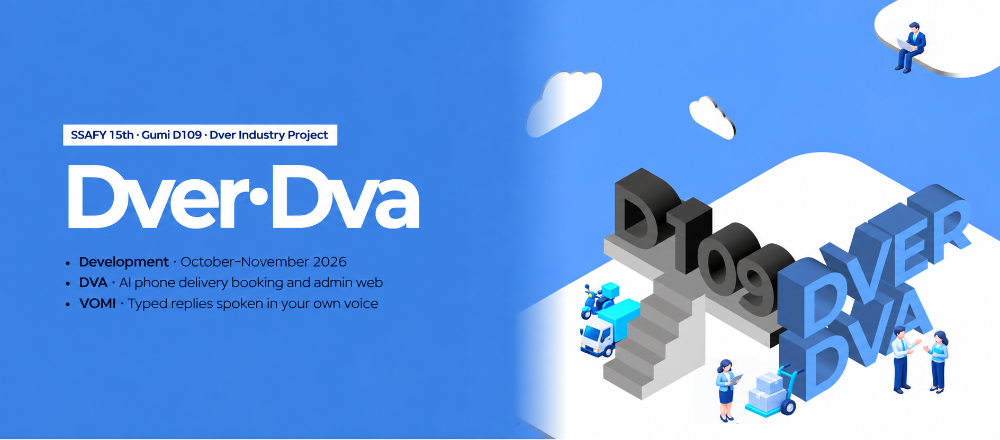
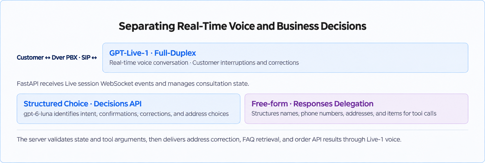
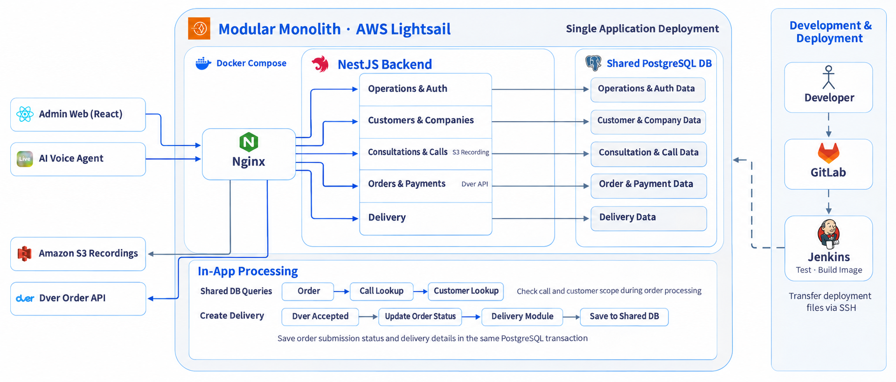
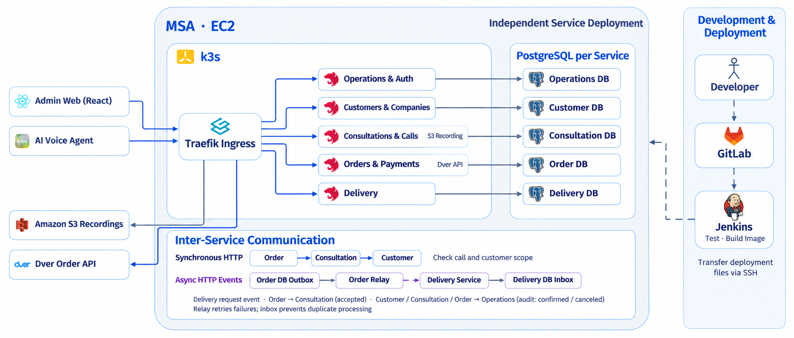

<p align="right"><a href="README.md">KR</a> | <strong>EN</strong></p>

# Dver·Dva

**SSAFY 15th Cohort, Gumi D109 · Industry Collaboration Project with Dver**



## 📌 Table of Contents

- [📦 DVA](#-dva)
  - [Service Flow](#-dva-service-flow)
  - [Demo Video](#-demo-video)
  - [Admin Web](#-admin-web)
  - [AI Consultation Technology](#-ai-consultation-technology)
  - [Architecture](#-architecture)
- [🎙 VOMI](#-vomi)
  - [Call Screen and Demo](#-call-screen-and-demo)
  - [Service Flow](#-vomi-service-flow)
  - [Speech Synthesis](#-speech-synthesis)
- [🛠 Tech Stack](#-tech-stack)
- [📁 Repository Structure](#-repository-structure)
- [👥 Team Members](#-team-members)

## 📦 DVA

**An AI agent for booking parcel deliveries by phone, with an admin web interface**

Customers provide delivery details over the phone, and the AI confirms addresses and items. Orders are submitted to Dver according to the applicable payment terms, while operators review call and order histories on the web.

### 🔄 DVA Service Flow


### 🎬 Demo Video

**Service Overview · 54 seconds**

https://github.com/user-attachments/assets/ec853ec0-89d9-4a39-928c-7d1c80c8dfd4

### 🖥 Admin Web

Screenshots of the admin web interface running with mock data.

| Home | Orders |
| :---: | :---: |
|  |  |
| Pending tasks and recent activity | Order search and submission status |

| Calls | AI Agents | Statistics |
| :---: | :---: | :---: |
|  |  |  |
| Call history and recordings | Voices, versions, and prompts | Order processing time and response waits |

- **Scenario Testing** · Before applying an AI agent prompt to live calls, the system runs voice conversations with simulated customers across 10 scenarios and automatically evaluates the results.
- **Call Complaint Detection** · After each call, the system identifies customer complaints and five types of AI response errors, displaying the results in call details and statistics (96% precision for customer complaint detection).

### 🤖 AI Consultation Technology



| Technology | Role |
| --- | --- |
| **GPT-Live-1** | Bidirectional voice interaction and interruption handling for incoming PBX calls |
| **Decisions API · `gpt-6-luna`** | Determines booking intent, confirmations and corrections, and address candidate selection |
| **Responses Delegation** | Extracts names, phone numbers, addresses, and items, and calls business tools |
| **FAQ Retrieval · RAG** | Combines Qdrant embedding search and Kiwi/BM25 search with RRF, then reranks results with Qwen3 |
| **Korean Address Correction** | Finds address candidates using a road-name address database and edit distance at the Korean jamo level |

- **Decision Response Time** · Decisions API warm-call median: **251ms**, P95: **284ms** (53 calls)
- **FAQ Retrieval** · With Qwen3 reranking, Top 1 accuracy improved from **71% → 96%**, and Top 3 from **86% → 100%**

### 📊 RAG Performance and Response Quality Evaluation

We evaluated retrieval accuracy and the quality of actual AI consultation responses using a **95-question golden dataset** that we built and reviewed ourselves.

#### Retrieval Performance

| Metric | Initial | Final |
| --- | ---: | ---: |
| Hit@1 | 70.5% (67/95) | **95.8% (91/95)** |
| Hit@3 | 86.3% (82/95) | **100% (95/95)** |

- **Average Retrieval Latency** · 270ms
- **P95 Retrieval Latency** · 328ms
- **Retrieval Pipeline** · Dense + Kiwi/BM25 → RRF → Qwen3 Reranker → Top3

#### Response Quality Evaluation with Ragas

We used Ragas to evaluate **the quality of actual Live voice responses**, in addition to retrieval results.

| Metric | Text LLM | Live Voice Responses |
| --- | ---: | ---: |
| Faithfulness | 0.9612 | 0.8579 |
| Answer Relevancy | 0.5934 | 0.4825 |
| Context Precision | 0.9807 | 0.9895 |
| Context Recall | 0.9789 | 0.9895 |
| Factual Correctness F1 | - | 0.7214 |


### 🏗 Architecture

Select an architecture below to view one diagram at a time.

<details name="dva-architecture" open>
<summary><strong>Modular Monolith · AWS Lightsail</strong></summary>



NestJS modules and PostgreSQL run together in Docker Compose. The admin web interface and AI agent access business APIs through Nginx.

</details>

<details name="dva-architecture">
<summary><strong>MSA Validation Environment · EC2 and k3s</strong></summary>



Business functions are split into five services with separate databases. Deployment uses k3s and Traefik, while Outbox/Inbox handles event retries and duplicates.

</details>

[Monolith ERD · DBML](docs/database/monolith.dbml)

## 🎙 VOMI


**A calling app that speaks your typed replies in your own voice when you cannot speak aloud**

When answering a call in a quiet place, you can choose a suggested reply or type your own. The other person receives the text immediately and can also hear the reply synthesized in your registered voice.

### 📱 Call Screen and Demo


**Speech Synthesis Comparison · 13 seconds**

https://github.com/user-attachments/assets/fae885d6-8131-4b5e-bf38-7e27e3afc403

**Listen to the Same Sentence** · [Original Recording](assets/vomi-original.wav) · [ElevenLabs](assets/vomi-elevenlabs.wav) · [OmniVoice + LoRA](assets/vomi-omnivoice.wav)

### 🔄 VOMI Service Flow


### 🔊 Speech Synthesis

We initially implemented in-call speech synthesis with **ElevenLabs**. To achieve the performance we needed for real-time calls, we fine-tuned locally running **OmniVoice** with **LoRA**.

- **Training Data** · We split 2 minutes and 33 seconds of recordings in a Busan dialect into 53 clips for training.
- **Synthesis Speed** · With FlashInfer, the median synthesis time for a 50-character sentence on an RTX 4070 dropped from **784ms → 412ms**.

## 🛠 Tech Stack

| Area | DVA | VOMI |
| --- | --- | --- |
| Frontend | React · TypeScript | Kotlin · Jetpack Compose |
| Backend & Database | NestJS · FastAPI · PostgreSQL | NestJS · PostgreSQL |
| Voice & AI | GPT-Live-1 · Decisions API · Qdrant · Qwen3 | LiveKit · ElevenLabs · Gemini Nano · OmniVoice |
| Deployment & Integrations | AWS Lightsail · S3 · Docker Compose · Jenkins · k3s | LiveKit Cloud · Firebase Cloud Messaging · Docker Compose |

## 📁 Repository Structure

```text
.
├── frontend/            # DVA admin web
├── ai/                  # DVA real-time voice consultation and FAQ retrieval
├── backend/             # DVA NestJS modular monolith
├── msa/                 # DVA MSA validation environment
│   ├── services/        # Operations, customer, consultation, order, and delivery services
│   ├── liquibase/       # Per-service database migrations
│   └── deploy/          # k3s deployment configuration
├── kick/                # VOMI
│   ├── vomi/            # Android app
│   ├── backend/         # Call, friend, and speech synthesis APIs
│   └── ai/              # On-device AI PoC
├── infra/               # AWS, Nginx, deployment, and observability configuration
├── postman/             # External API simulation
├── docs/                # Design and API documentation
├── exec/                # Project setup and deployment manual
├── assets/              # README images, videos, and audio
├── compose.yaml         # Local runtime environment
└── compose.prod.yaml    # Production runtime environment
```

## 👥 Team Members

| [](https://github.com/jlkim909) | [](https://github.com/Jiwoo-Kim0) | [](https://github.com/jihwan4155) | [](https://github.com/hantawon123) | [](https://github.com/sejhyun13) | [](https://github.com/42JH) |
| :---: | :---: | :---: | :---: | :---: | :---: |
| [Min-guk Yu](https://github.com/jlkim909) | [Ji-woo Kim](https://github.com/Jiwoo-Kim0) | [Ji-hwan Shin](https://github.com/jihwan4155) | [Tae-won Han](https://github.com/hantawon123) | [Seung-jun Hyun](https://github.com/sejhyun13) | [Jae-hoon Lee](https://github.com/42JH) |
| Team Lead · Backend<br>Orders & Payments | Admin Web<br>AI Agent Settings | DVA Phone Consultation<br>RAG Design/Evaluation<br>VOMI On-device AI| Backend · MSA · CI<br>VOMI Calls & Voice | DVA Conversation Control · Decision API<br>Addresses & Model Delegation | Frontend Lead · UI Design · Deployment<br>Scenario Testing & Complaint Detection |
